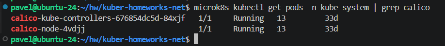
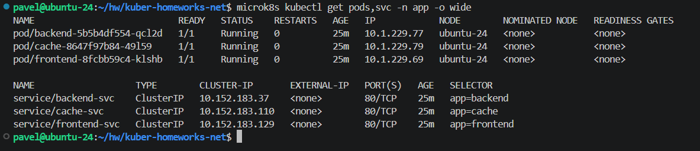
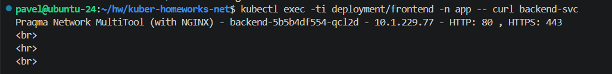
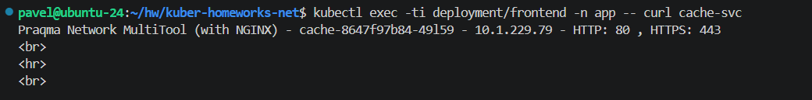
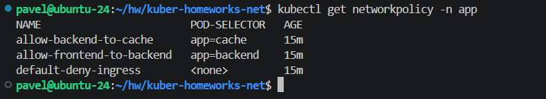
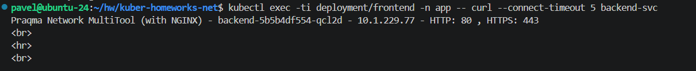
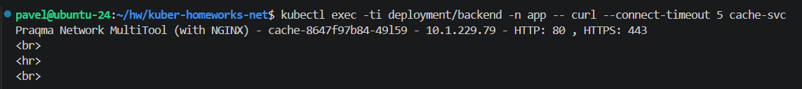
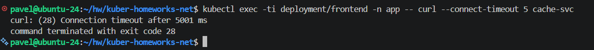
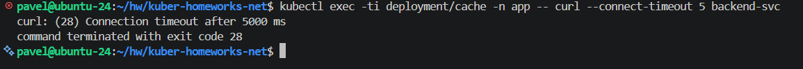

# Домашнее задание к занятию «Как работает сеть в K8s» - Рыбянцев Павел

Репозиторий содержит манифесты и описание процесса настройки сетевых политик доступа (`NetworkPolicy`) для обеспечения безопасности и изоляции трафика внутри кластера Kubernetes (MicroK8s) с использованием сетевого плагина **Calico**.

---

## 1. Цель и логика сетевой изоляции

Согласно техническому заданию, необходимо развернуть три компонента приложения (`frontend`, `backend`, `cache`) в изолированном пространстве имён `app` и обеспечить строго направленный пропуск трафика по цепочке:
**frontend -> backend -> cache**

Любые другие сетевые взаимодействия (например, прямой доступ из `frontend` в `cache` или запросы в обратном направлении) должны полностью блокироваться на сетевом уровне.

Для реализации этой логики применён подход **Default Deny** (запрещено всё, что явно не разрешено):
1. Создана политика `default-deny-ingress`, блокирующая весь входящий трафик к любым подам в namespace `app`.
2. Создана политика `allow-frontend-to-backend`, точечно разрешающая входящий трафик на поды с лейблом `app: backend` только от подов с лейблом `app: frontend`.
3. Создана политика `allow-backend-to-cache`, точечно разрешающая входящий трафик на поды с лейблом `app: cache` только от подов с лейблом `app: backend`.

---

## 2. Развёртывание окружения

Все компоненты развёрнуты в пространстве имён `app`. В качестве базового образа для подов используется контейнер `network-multitool` для удобства тестирования сетевой связности (`curl`, `ping`).

### Шаг 2.1. Проверка работы CNI Calico в кластере
Убеждаемся, что сетевой плагин Calico активен и управляет сетью кластера:
```bash
microk8s kubectl get pods -n kube-system | grep calico
```


### Шаг 2.2. Применение манифестов приложений
Создаём namespace, деплойменты и сервисы:
```bash
microk8s kubectl apply -f manifests/00-namespace.yaml
microk8s kubectl apply -f manifests/01-app-deployments.yaml
```

Проверяем успешный запуск всех подов и доступность сервисов внутри пространства имён `app`:
```bash
microk8s kubectl get pods,svc -n app -o wide
```


---

## 3. Тестирование сетевой связности

### Шаг 3.1. Проверка связи ДО применения сетевых политик
По умолчанию в Kubernetes сеть открыта. Проверяем, что `frontend` имеет беспрепятственный доступ как к `backend`, так и напрямую к `cache`:

```bash
# Проверка связи frontend -> backend
microk8s kubectl exec -ti deployment/frontend -n app -- curl --connect-timeout 5 backend-svc

# Проверка связи frontend -> cache
microk8s kubectl exec -ti deployment/frontend -n app -- curl --connect-timeout 5 cache-svc
```



### Шаг 3.2. Применение сетевых политик (NetworkPolicy)
Включаем правила изоляции трафика:
```bash
microk8s kubectl apply -f manifests/02-network-policies.yaml
```

Проверяем, что политики успешно созданы в кластере:
```bash
microk8s kubectl get networkpolicy -n app
```


### Шаг 3.3. Финальная проверка связности ПОСЛЕ применения политик

Запускаем тесты для демонстрации корректности работы настроенных правил:

1. **Разрешённый трафик `frontend -> backend` (Должен работать):**
   ```bash
   microk8s kubectl exec -ti deployment/frontend -n app -- curl --connect-timeout 5 backend-svc
   ```


2. **Разрешённый трафик `backend -> cache` (Должен работать):**
   ```bash
   microk8s kubectl exec -ti deployment/backend -n app -- curl --connect-timeout 5 cache-svc
   ```


3. **Запрещённый трафик `frontend -> cache` (Должен упасть по таймауту):**
   ```bash
   microk8s kubectl exec -ti deployment/frontend -n app -- curl --connect-timeout 5 cache-svc
   ```


4. **Запрещённый трафик `cache -> backend` (Должен упасть по таймауту):**
   ```bash
   microk8s kubectl exec -ti deployment/cache -n app -- curl --connect-timeout 5 backend-svc
   ```


## Вывод
Задачи по разграничению прав доступа на сетевом уровне внутри Kubernetes успешно выполнены. Использование связки `NetworkPolicy` + `Calico` позволило реализовать безопасный периметр для микросервисов, исключая несанкционированный доступ между слоями приложения (минуя backend).
